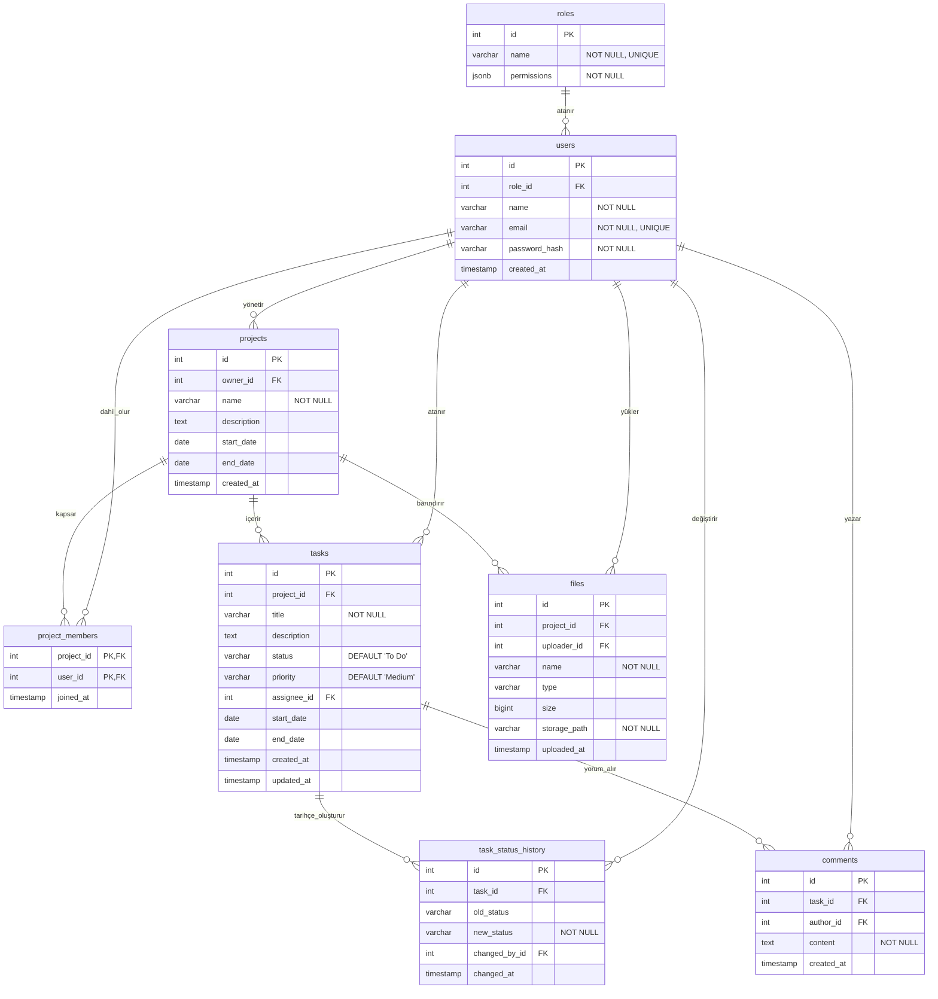

# SEK TECH 2026 — Veri Tabanı ve DevOps Çıktıları

**Sorumlu:** Buğra Durmuş (Veri Tabanı Yöneticisi / DevOps)  
**Proje:** Proje Yönetim Sistemi (Azure Boards İlhamlı Web Platformu)  
**Kapsam:** Sprint 0 (H1), Sprint 1 (H2), Sprint 2 (H3), Sprint 3 (H4), Sprint 4 (H5 - #52), Sprint 5 (H6 - #59)  
**İlgili GitHub Issue'ları:** [#24](https://github.com/Utkuuzun14/proje-yonetim-sistemi/issues/24), [#31](https://github.com/Utkuuzun14/proje-yonetim-sistemi/issues/31), [#38](https://github.com/Utkuuzun14/proje-yonetim-sistemi/issues/38), [#45](https://github.com/Utkuuzun14/proje-yonetim-sistemi/issues/45), [#52](https://github.com/Utkuuzun14/proje-yonetim-sistemi/issues/52), [#59](https://github.com/Utkuuzun14/proje-yonetim-sistemi/issues/59)

---

## 1. Sprint 0: Teknik Kararlar, Karşılaştırma ve Varlık Listesi (Issue #24)

### 1.1 Veri Tabanı Seçenekleri Karşılaştırması

Proje Yönetim Platformunun gereksinimleri (özellikle **M5: Raporlama & Analiz**, görev geçmişi takibi, çok kullanıcılı yetkilendirme ve proje-görev hiyerarşisi) doğrultusunda 3 temel veri tabanı seçeneği değerlendirilmiştir:

| Değerlendirme Kriteri | PostgreSQL (Seçilen) | MySQL | MongoDB |
|---|---|---|---|
| **Veri Modeli** | Güçlü İlişkisel (RDBMS) + Nesne Tabanlı | İlişkisel (RDBMS) | Doküman Tabanlı (NoSQL) |
| **ACID Uyumu** | Tam, endüstri standardı | InnoDB motoru ile tam | Koleksiyon/doküman düzeyinde, karmaşık işlemlerde maliyetli |
| **Gelişmiş Veri Tipleri** | `JSONB`, `UUID`, zengin `TIMESTAMP/TZ` | Sınırlı JSON desteği | Doğal BSON/JSON |
| **Karmaşık Raporlama & Analiz** | **Mükemmel:** Pencere fonksiyonları (Window Functions), CTE'ler, tarih/durum analizi sorguları | İyi, ancak karmaşık analitik sorgularda optimizasyon sınırlı | **Yetersiz:** Çoklu koleksiyon `$lookup` (JOIN) sorguları raporlamada performans kaybı yaratır |
| **İlişkisel Bütünlük (FK)** | Kapsamlı kısıtlama ve CASCADE desteği | Kapsamlı | Uygulama katmanında yönetilmek zorunda |
| **Ekip Deneyimi & Entegrasyon** | Node.js / Express (`pg`, `Prisma`, `TypeORM`) ile kusursuz uyum | Yüksek | Yüksek |

> **Karar Gerekçesi:**  
> M5 modülünün gerektirdiği haftalık/aylık ilerleme raporları, burndown verileri ve görev durum geçmişi analitiği; tablolar arası yoğun `JOIN`, tarih bazlı gruplama ve pencere fonksiyonları gerektirmektedir. Ayrıca `roles.permissions` alanında `JSONB` formatı kullanarak şemayı esnek tutma imkânı sunması nedeniyle **PostgreSQL 15** projenin ana veri tabanı olarak seçilmiştir.

### 1.2 Temel Varlık Listesi ve Öznitelik Tanımları

Sistemin ilk aşama analizi sonucunda belirlenen 8 temel varlık:

1. **Rol (`roles`):** Sistemdeki kullanıcı rollerini (Yönetici, Ekip Üyesi) ve `JSONB` tipinde yetki matrisini barındırır.
2. **Kullanıcı (`users`):** Sisteme kaydolan ekip üyelerini, iletişim bilgilerini ve parola özetlerini tutar.
3. **Proje (`projects`):** Yönetilen projeleri, açıklama ve başlangıç/bitiş takvimlerini saklar.
4. **Proje Üyeliği (`project_members`):** Kullanıcılar ile projeler arasındaki çoka-çok (M:N) ilişkiyi modeller.
5. **Görev (`tasks`):** Bir projeye ait görevleri, iş durumunu (To Do, In Progress, Done), öncelik derecesini ve atanan kişiyi tutar.
6. **Görev Durum Geçmişi (`task_status_history`):** Durum değişikliklerini zaman damgasıyla kaydederek burndown ve hız (velocity) raporlamasına temel oluşturur.
7. **Yorum (`comments`):** Görev detayları üzerinde ekip üyeleri arasındaki iletişimi sağlar.
8. **Dosya (`files`):** Projeye yüklenen dokümanların meta verilerini ve depolama yollarını saklar.

### 1.3 Yerel Geliştirme Ortamı Planı

Geliştiricilerin yerel makinelerinde harici veri tabanı kurulumlarıyla uğraşmaması ve ortamlar arası tutarlılığı sağlamak amacıyla **Docker Compose** stratejisi belirlenmiştir:
- Geliştirme sürecinde veri tabanı tek başına `database/docker-compose.yml` ile izole şekilde çalıştırılabilir.
- Tam sistem entegrasyonunda kök dizindeki `docker-compose.yml` kullanılarak PostgreSQL, Node.js API ve React istemcisi tek komutla ayağa kaldırılır.

---

## 2. Sprint 1: Sistem Tasarımı & ER Diyagramı v1 (Issue #31)

### 2.1 3NF Uyumlu İlişkisel Şema Tasarımı

Şema, Üçüncü Normal Form (3NF) kurallarına tam uyumlu olacak şekilde tasarlanmıştır:
- **1NF:** Tüm sütunlar atomik değerler içerir; tekrarlayan gruplar yoktur.
- **2NF:** Birincil anahtara (PK) kısmi bağımlılıklar giderilmiş, ara tablolar (`project_members`) ile çoka-çok ilişkiler normalize edilmiştir.
- **3NF:** Birincil anahtar harici öznitelikler arasında geçişli bağımlılıklar (transitive dependency) yoktur.

### 2.2 Varlık-İlişki (ER) Diyagramı



### 2.3 Görev Durum Geçmişi Tablosunun Önemi

`task_status_history` tablosu, proje yönetim sistemlerinde raporlama modülü için kritik bir bileşendir:
- Görevin hangi tarihte hangi aşamada ne kadar beklediğini (Cycle Time & Lead Time) hesaplamayı sağlar.
- Burndown ve Burnup grafiklerinin geçmişe dönük doğru çizilmesine imkân verir.
- Kimin ne zaman durum değiştirdiğini denetim izi (audit log) olarak kayıt altına alır.

### 2.4 Yerel Veri Tabanı Geliştirme Ortamı

Yalnızca veri tabanını izole ayağa kaldırmak isteyen geliştiriciler için `database/docker-compose.yml` yapılandırılmıştır:

```bash
# Veri tabanını arka planda başlatma
cd database
docker compose up -d

# Logları takip etme
docker compose logs -f db

# Ortamı durdurma
docker compose down
```

---

## 3. Sprint 2: Altyapı Kurulumu, Şema Migration ve Seed (Issue #38)

### 3.1 Şema Migration Dosyası (`database/init.sql`)

Tüm 8 tabloyu, yabancı anahtarları (`FOREIGN KEY`), bütünlük kısıtlarını (`NOT NULL`, `UNIQUE`, `ON DELETE CASCADE/SET NULL`) ve performans indekslerini içeren eksiksiz migration betiğidir.

- **Dosya Yolu:** [`database/init.sql`](init.sql)
- **Kapsanan Tablolar:** `roles`, `users`, `projects`, `project_members`, `tasks`, `task_status_history`, `comments`, `files`.
- **İndeksleme Stratejisi:** Sık sorgulanan sütunlar (`email`, `project_id`, `assignee_id`, `status`, `task_id`) B-Tree indeksleriyle optimize edilmiştir.

### 3.2 Örnek (Seed) Veri Betiği (`database/seed.sql`)

Geliştirme ve test süreçlerinde sistemin hemen kullanılabilir olmasını sağlayan gerçekçi başlangıç verileridir.

- **Dosya Yolu:** [`database/seed.sql`](seed.sql)
- **Eklenen Veriler:**
  - 2 Sistem Rolü (`Yönetici`, `Ekip Üyesi`) ve izin tanımları,
  - 7 SEK TECH Ekip Üyesi (Hakan Koço, Abdulkahhar Türkoğlu, Mert Yanık, Ümit Efe Özkaleli, Mustafa Şahin, Buğra Durmuş, Utku Uzun),
  - 1 Örnek Proje (`SEK TECH Proje Yönetim Platformu`),
  - 7 Proje Üyelik Kaydı,
  - 6 Örnek Görev (Sprint 0, 1 ve 2 aktivitelerini yansıtan görevler),
  - Görev durum geçmişi kayıtları ve ekip içi yorumlar,
  - Örnek dosya meta verileri.

### 3.3 Tek Komutla Kurulum Orkestrasyonu (`docker-compose.yml`)

Projenin kök dizinindeki [`docker-compose.yml`](../docker-compose.yml), tüm sistemi (PostgreSQL 15, Node.js API, React Web) tek bir komutla başlatır:

```yaml
version: '3.8'

services:
  db:
    image: postgres:15-alpine
    container_name: sektech-db
    restart: unless-stopped
    environment:
      POSTGRES_USER: admin
      POSTGRES_PASSWORD: password
      POSTGRES_DB: sektech
    ports:
      - "5433:5432"
    volumes:
      - pgdata:/var/lib/postgresql/data
      - ./database/init.sql:/docker-entrypoint-initdb.d/01-init.sql:ro
      - ./database/seed.sql:/docker-entrypoint-initdb.d/02-seed.sql:ro
    healthcheck:
      test: ["CMD-SHELL", "pg_isready -U admin -d sektech"]
      interval: 5s
      timeout: 5s
      retries: 5

  server:
    build:
      context: ./server
      dockerfile: Dockerfile
    container_name: sektech-server
    restart: unless-stopped
    ports:
      - "5000:5000"
    depends_on:
      db:
        condition: service_healthy
    environment:
      PORT: 5000
      DATABASE_URL: postgresql://admin:password@db:5432/sektech
      JWT_SECRET: dev-jwt-secret-key-sektech-2026

  client:
    build:
      context: ./client
      dockerfile: Dockerfile
    container_name: sektech-client
    restart: unless-stopped
    ports:
      - "3000:3000"
    depends_on:
      - server

volumes:
  pgdata:
```

---

## 4. Doğrulama ve Test Adımları

Sistem ayağa kaldırıldığında aşağıdaki komutlarla doğrulanabilir:

```bash
# 1. Sistemi başlatma
#    Veri tabanı + API (client iskeleti henüz yok):
docker compose up --build -d
#    Client eklenince tüm sistem (db + server + client):
docker compose --profile app up --build -d

# 2. Veri tabanı tablolarını kontrol etme
docker exec -it sektech-db psql -U admin -d sektech -c "\dt"

# 3. Seed verisi doğrulaması
docker exec -it sektech-db psql -U admin -d sektech -c "SELECT id, name, email FROM users;"
docker exec -it sektech-db psql -U admin -d sektech -c "SELECT id, title, status FROM tasks;"

# 4. İlişki sorgusu doğrulaması
docker exec -it sektech-db psql -U admin -d sektech -c "
SELECT t.title, u.name AS atanan, t.status, p.name AS proje
FROM tasks t
JOIN users u ON t.assignee_id = u.id
JOIN projects p ON t.project_id = p.id;
"
```

---

## 5. Sprint 3: Rol, Yetki ve Proje Üyeliği Tabloları (Issue #45)

**Hafta:** H4 · 26 Ekim – 1 Kasım 2026  
**Kilometre Taşı:** M3 · MVP & ara demo  
**Hedef:** Rol tabanlı yetkilendirmeyi (RBAC) ve proje oluşturma–düzenleme akışını uçtan uca çalıştırmak.

### 5.1 Şema İyileştirmeleri ve Bütünlük Kısıtları

Sprint 3 kapsamında iş kurallarının ve veri bütünlüğünün doğrudan veritabanı katmanında garantiye alınması amacıyla aşağıdaki iyileştirmeler yapılmıştır:

1. **Tarih Kontrol Kısıtı (`chk_projects_dates`):**
   - **Kural:** `CHECK (end_date IS NULL OR start_date IS NULL OR end_date >= start_date)`
   - **Gerekçe:** US-03 ve TS-PRJ-02 kabul kriterlerine göre bitiş tarihi başlangıç tarihinden önce olan projelerin oluşturulması engellenmelidir. Bu kısıt ile hatalı veri girişi veritabanı düzeyinde imkânsız hale getirilmiştir.
2. **Roller JSONB GIN İndeksi (`idx_roles_permissions`):**
   - **Kural:** `CREATE INDEX idx_roles_permissions ON roles USING GIN (permissions);`
   - **Gerekçe:** Kullanıcıların yetki kontrollerinde JSONB içerisindeki izinlerin (`permissions ? 'project:delete'` veya `permissions @> '{"project:delete": true}'`) $O(1)$ maliyetle taranabilmesi sağlanmıştır.
3. **Proje Tarih ve Listeleme İndeksleri:**
   - `idx_projects_dates ON projects(start_date, end_date)`: Takvim ve zaman aralığı sorguları için.
   - `idx_projects_created_at ON projects(created_at DESC)`: Varsayılan proje listelemelerinde sıralama optimizasyonu için.

### 5.2 Standartlaştırılmış RBAC Yetki Matrisi

Sistemdeki rollerin sahip olduğu izinler `roles.permissions` alanında standartlaştırılmış modül:eylem biçiminde yapılandırılmıştır:

| İzin Anahtarı | Yönetici (Admin) | Ekip Üyesi (Member) | Açıklama |
|---|:---:|:---:|---|
| `user:read` | ✅ | ✅ | Kullanıcı listesini ve profilleri görüntüleme |
| `user:create` | ✅ | ❌ | Yeni kullanıcı kaydetme / davet etme |
| `user:assign_role` | ✅ | ❌ | Kullanıcının rolünü değiştirme |
| `project:create` | ✅ | ❌ | Yeni proje oluşturma |
| `project:read` | ✅ | ✅ | Dahil olduğu projeleri görüntüleme |
| `project:update` | ✅ | ❌ | Proje bilgilerini ve tarihlerini düzenleme |
| `project:delete` | ✅ | ❌ | Projeyi silme (yalnızca Yönetici) |
| `project:add_member` | ✅ | ❌ | Projeye üye ekleme |
| `project:remove_member`| ✅ | ❌ | Projeden üye çıkarma |
| `task:create` | ✅ | ❌ | Görev açma (Sprint 4) |
| `task:read` | ✅ | ✅ | Görevleri listeleme ve detay görme |
| `task:update_status` | ✅ | ✅ | Görevin durumunu değiştirme (To Do -> In Progress -> Done) |
| `comment:create` | ✅ | ✅ | Göreve yorum yazma |
| `file:upload` | ✅ | ✅ | Projeye doküman yükleme |
| `report:view` | ✅ | ❌ | Tüm proje ve ekip metriklerini görme |
| `report:view_self` | ✅ | ✅ | Kendi görev karnesini görme |

### 5.3 Backend Sorgu & Repository Desteği (Mustafa - #44)

Mustafa'nın Sprint 3 Proje API'si ve RBAC middleware geliştirimini hızlandırmak amacıyla repository katmanı hazırlanmıştır:

1. **`server/src/modules/projects/projects.repository.js`:**
   - `create({ name, description, startDate, endDate, ownerId })`: Projeyi oluşturur; eş zamanlı transaction içinde proje sahibini `project_members` tablosuna ekler.
   - `findById(id)`: Projeyi sahibi ve üye sayısıyla (`member_count`) birlikte çeker.
   - `list({ userId, isAdmin })`: Yetki bazlı listeleme yapar. Yöneticiye tüm projeleri; üyeye yalnızca üyesi olduğu projeleri döner (`TS-ROL-04` izolasyonu).
   - `update(id, data)`: Dinamik parametreli güvenli güncelleme yapar.
   - `delete(id)`: Projeyi ve bağlı tüm kayıtları siler.
   - `addMember(projectId, userId)` / `removeMember(projectId, userId)`: Üyelik yönetimi.
   - `listMembers(projectId)`: Proje üyelerini rolleriyle döner.
   - `isMember(projectId, userId)` / `isOwner(projectId, userId)`: Hızlı erişim kontrol boolean sorguları.

2. **`server/src/modules/users/users.repository.js` Güncellemeleri:**
   - `updateRole(userId, roleName)`: Kullanıcıya rol atama sorgusu.
   - `listRoles()`: Sistemdeki rolleri ve izin JSONB matrisini listeleme.
   - `getRolePermissions(roleName)`: RBAC middleware'inin tek sorguda izin doğrulaması yapmasını sağlayan yardımcı fonksiyon.
   - `findByIdWithPermissions(id)`: Kullanıcının rolünü ve izinlerini birleştirerek getiren fonksiyon.

### 5.4 Test Senaryoları Uyumluluğu

- **TS-PRJ-02 (Geçersiz Proje Tarihleri):** `chk_projects_dates` kısıtı ile bitiş < başlangıç olan durumlar veritabanında engellenir.
- **TS-ROL-04 (Proje İzolasyonu):** Tohum verisine eklenen 2. Proje (`Mobil Saha Yönetimi`) ve üyelik ayrımı sayesinde yetkisiz üyenin başka projeyi görememesi doğrulanabilir.

---

## 6. Sprint 4: Şema v2, Görev Türü, Durum Geçmişi ve Tohum Verisi (Issue #52)

### 6.1 Karar 9–11 Kapsam Kararları ve Yetki Matrisi Güncellemesi

Hakan'ın Sprint 4 açılışında açıkladığı Karar 9–11 doğrultusunda yetki matrisi ve veri tabanı kısıtları güncellenmiştir:
- **Karar 9 (Ekip Üyesi Görev Açma):** Ekip Üyesi dahil olduğu projelerde yeni görev oluşturabilir (`task:create: true`). Bu yetki `roles` tablosundaki `Ekip Üyesi` rolünün permissions JSONB matrisine işlenmiştir.
- **Karar 10 (Görev Atama ve Düzenleme İzolasyonu):** Ekip Üyesi yalnızca kendisine atanmış görevleri düzenleyebilir; atama ve başkasının görevini düzenleme Yönetici rolündedir. Ancak durum değiştirme (`task:update_status`) tüm proje üyelerine açıktır.
- **Karar 11 (Görev Türü):** `tasks` tablosuna `type` sütunu (`Task`, `Bug`, `Feature`) eklenmiştir.

Güncellenmiş yetki matrisi:
| İzin Anahtarı | Yönetici | Ekip Üyesi | Sprint 4 Değişikliği |
|---|:---:|:---:|---|
| `task:create` | ✅ | ✅ | **Karar 9 gereği eklendi** |
| `task:read` | ✅ | ✅ | Korundu |
| `task:update` | ✅ | ❌ | Yalnız Yönetici (Üye yalnız kendi görevini düzenler) |
| `task:update_status` | ✅ | ✅ | Tüm üyeler durum değiştirebilir |
| `task:assign` | ✅ | ❌ | Yalnız Yönetici |
| `task:delete` | ✅ | ❌ | Yalnız Yönetici |

### 6.2 Sıralı Migration Mimarisi (`database/migrations/`)

`database/init.sql` dosyasındaki yıkıcı `DROP TABLE ... CASCADE` komutlarının çalışan veri tabanlarında veri kaybına yol açmasını engellemek üzere Utku'nun inceleme notu doğrultusunda **sıralı ve yalnızca ileri yönlü (forward-only)** migration mimarisine geçilmiştir:

1. **`001_baslangic.sql`:** Sprint 2 ve 3 kapsamında kurulan temel tabloları ve indeksleri idempotent (`CREATE TABLE IF NOT EXISTS`) biçimde oluşturur.
2. **`002_gorev_turu.sql`:**
   - `tasks` tablosuna `type VARCHAR(20) NOT NULL DEFAULT 'Task'` sütununu ekler.
   - `chk_tasks_type` kısıtını tanımlar (`type IN ('Task', 'Bug', 'Feature')`).
   - `chk_tasks_dates` kısıtını ekleyerek `end_date >= start_date` kuralını güvenceye alır.
   - Takvim, Gantt ve filtreleme sorgularını hızlandırmak üzere `idx_tasks_project_dates` ve `idx_tasks_type` indekslerini kurar.

### 6.3 Atomik Durum Geçmişi Mimarisi (`task_status_history`)

FR-08 ve US-05 gereksinimleri gereğince, görev durumu her değiştiğinde (`To Do` -> `In Progress` -> `Done`), değişimin eski durumu, yeni durumu, değiştiren kullanıcı ve zaman damgası `task_status_history` tablosuna kaydedilmektedir.
- **Eşzamanlılık ve Satır Kilidi:** `SELECT status FROM tasks WHERE id = $1 FOR UPDATE` ile yarış durumları (race condition) engellenir.
- **Atomik Transaction:** Durum güncellemesi ile tarihçe kaydı tek bir veritabanı transaction'ı (`BEGIN ... COMMIT`) içerisinde icra edilir; herhangi bir hata durumunda `ROLLBACK` yapılır.

### 6.4 Gerçekçi MVP Demo Tohum Verisi (`seed.sql`)

Kanban panosunun, filtrelerin ve MVP demosunun zengin bir veri setiyle doğrulanabilmesi amacıyla `database/seed.sql` güncellenmiştir:
- İki farklı projede (`SEK TECH Proje Yönetim Platformu`, `Mobil Saha Yönetimi`) toplam **17 görev**.
- Görevler Kanban durumlarına dengeli dağıtılmıştır: `To Do` (5 adet), `In Progress` (5 adet), `Done` (7 adet).
- Görev türleri (`Task`, `Bug`, `Feature`) ve öncelik seviyeleri (`Low`, `Medium`, `High`, `Critical`) gerçek senaryoları simüle eder.
- Ekip üyelerine (Hakan, Abdulkahhar, Mert, Ümit Efe, Mustafa, Buğra, Utku) dengeli iş atamaları yapılmıştır.
- Tüm tamamlanan ve süren işlerin gerçekçi durum geçiş tarihçesi (`task_status_history`) ve ekip içi yorumlaşmaları (`comments`) eklenmiştir.

### 6.5 CI ve Test Ortamı Uyumu

`server/tests/helpers/globalSetup.js` güncellenerek test veritabanının sıfırdan kurulmasında `init.sql` sonrasında `database/migrations/` altındaki tüm `.sql` dosyalarının alfabetik sırayla otomatik çalıştırılması sağlanmıştır. Böylece yerel geliştirme, Docker Compose ve CI ortamlarında birebir aynı veri şeması garanti edilmiştir.

---

## 7. Sprint 5: Dosya Metadata Tablosu, Depolama Stratejisi ve Staging Ortamı (Issue #59)

### 7.1 Dosya Metadata Tasarımı ve Göreve Dosya Bağlama (`003_dosya_gorev_baglantisi.sql`)

Sprint 5 (Modül 4: Dokümantasyon & Dosya Paylaşımı) gereksinimleri ve Karar 11 kapsamında:
- `files` tablosuna `task_id INT REFERENCES tasks(id) ON DELETE SET NULL` sütunu eklenmiştir. Böylece yüklenen bir doküman doğrudan bir görevle ilişkilendirilebilmektedir. Görevin silinmesi durumunda dosya veri tabanından ve depolamadan silinmez, yalnızca `task_id` alanı `NULL` yapılarak projeye bağlı kalmaya devam eder.
- Görev dosyalarının hızlıca sorgulanabilmesi amacıyla `idx_files_task` indeksi eklenmiştir.

### 7.2 Güvenli Depolama Stratejisi (UUID ve İzolasyon)

SRS FR-13 ve FR-14 gereksinimleri doğrultusunda dosya saklama kuralları tanımlanmıştır:
1. **Orijinal Dosya Adı İzolasyonu:** Yüklenen dosyanın orijinal adı (`name`) meta veri olarak veritabanında saklanır; dosya sistemindeki fiziksel dosya adı ise rastgele üretilen bir `UUID` (ör. `a8b2c3d4-...`) ile şifrelenir (`storage_path`). Bu sayede dizin atlama (path traversal) ve dosya adı çakışmaları tamamen önlenir.
2. **Statik Sunum Yasağı (Direct Serving Block):** Yüklenen dosyalar public bir HTTP dizini altından doğrudan statik servis edilmez. Tüm indirmeler `/api/files/:id/download` uç noktası üzerinden JWT oturumu ve proje üyelik denetimi ile `res.download()` üzerinden servis edilir.
3. **Boyut ve Tür Sınırları:** 10 MB dosya boyutu üst sınırı tanımlanmış; izin verilen MIME türleri (PDF, PNG, JPG, JPEG, TXT, DOCX, XLSX, ZIP) ve bayt imzası (magic byte) kontrolü ile doğrulanmıştır.

### 7.3 Staging (Ön Yayın) Ortamı Kurulumu (`docker-compose.staging.yml`)

Geliştirme ortamından bağımsız, prodüksiyon standartlarına sahip staging ortamı kurulmuştur:
- **İzole Ağ ve Konteynerler:** `staging-db` (Postgres 15, `sektech_staging` VT), `staging-server` (Express API) ve `staging-client` (React + Nginx) izole köprü ağında (`staging-net`) çalışır.
- **Port Ayrımı:** Yerel geliştirme portlarıyla (5433, 5000, 3000) çakışmayı önlemek için staging ortamı `5434:5432` (VT), `5001:5000` (API) ve `3001:80` (Arayüz) portlarını kullanır.
- **Kalıcı Depolama (Persistent Volumes):** `staging_pgdata` ile veri tabanı verileri, `staging_uploads` ile yüklenen dokümanlar konteyner yeniden başlatmalarında korunur.
- **Sağlık Kontrolleri:** Veri tabanı için `pg_isready`, backend için `/api/health` sağlık kontrolleri yapılandırılmıştır.
- **Dağıtım Otomasyonu:** `scripts/staging-deploy.sh` ve `scripts/staging-deploy.ps1` betikleri ile tek komutla ayağa kaldırma ve otomatik HTTP doğrulama sağlanmıştır.

### 7.4 Backend Dosya Servisi Entegrasyon Desteği (Mustafa - #58)

Mustafa'nın dosya yükleme ve indirme API'sini geliştirmesini kolaylaştırmak üzere:
- `files.repository.js` için `createFile({ projectId, taskId, uploaderId, name, type, size, storagePath })`, `findById(id)`, `listByProject(projectId)`, `listByTask(taskId)`, `deleteFile(id)` sorguları optimize edilmiştir.
- `docker-compose.yml` ve staging yapılandırmasında `UPLOAD_DIR: /app/uploads` çevre değişkeni standartlaştırılmıştır.
