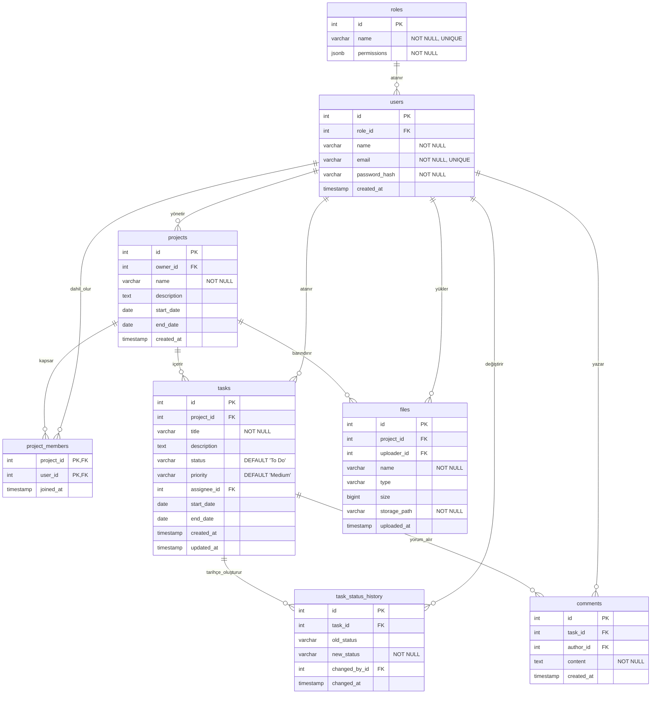

# SEK TECH 2026 — Veri Tabanı ve DevOps Çıktıları

**Sorumlu:** Buğra Durmuş (Veri Tabanı Yöneticisi / DevOps)  
**Proje:** Proje Yönetim Sistemi (Azure Boards İlhamlı Web Platformu)  
**Kapsam:** Sprint 0 (H1), Sprint 1 (H2), Sprint 2 (H3)  
**İlgili GitHub Issue'ları:** [#24](https://github.com/Utkuuzun14/proje-yonetim-sistemi/issues/24), [#31](https://github.com/Utkuuzun14/proje-yonetim-sistemi/issues/31), [#38](https://github.com/Utkuuzun14/proje-yonetim-sistemi/issues/38)

---

## 1. Sprint 0: Teknik Kararlar, Karşılaştırma ve Varlık Listesi (Issue #24)

### 1.1 Veri Tabanı Seçenekleri Karşılaştırması

Proje Yönetim Platformunun gereksinimleri (özellikle **M5: Raporlama & Analiz**, görev geçmişi takibi, çok kullanıcılı yetkilendirme ve proje-görev hiyerarşisi) doğrultusunda 3 temel veri tabanı seçeneği değerlendirilmiştir:

| Değerlendirme Kriteri | PostgreSQL (Seçilen) | MySQL | MongoDB |
|---|---|---|---|
| **Veri Modeli** | Güçlü İlişkisel (RDBMS) + Nesne Tabanlı | İlişkisel (RDBMS) | Doküman Tabanlı (NoSQL) |
| **ACID Uyumu** | Tam, endüstri standardı | InnoDB motoru ile tam | Koleksiyon/doküman düzeyinde, karmaşık işlemlerde maliyetli |
| **Gelişmiş Veri Tipleri** | `JSONB`, `UUID`, zengin `TIMESTAMP/TZ` | Sınırlı JSON desteği | Doğal BSON/JSON |
| **Karmaşık Raporlama & Analiz** | **Mükemmel:** Pencere fonksiyonları (Window Functions), CTE'ler, tarih/durum analizi sorguları | İyi, ancak karmaşık analitik sorgularda optimizasyon sınırlı | **Yetersiz:** Çoklu koleksiyon `$lookup` (JOIN) sorguları raporlamada performans kaybı yaratır |
| **İlişkisel Bütünlük (FK)** | Kapsamlı kısıtlama ve CASCADE desteği | Kapsamlı | Uygulama katmanında yönetilmek zorunda |
| **Ekip Deneyimi & Entegrasyon** | Node.js / Express (`pg`, `Prisma`, `TypeORM`) ile kusursuz uyum | Yüksek | Yüksek |

> **Karar Gerekçesi:**  
> M5 modülünün gerektirdiği haftalık/aylık ilerleme raporları, burndown verileri ve görev durum geçmişi analitiği; tablolar arası yoğun `JOIN`, tarih bazlı gruplama ve pencere fonksiyonları gerektirmektedir. Ayrıca `roles.permissions` alanında `JSONB` formatı kullanarak şemayı esnek tutma imkânı sunması nedeniyle **PostgreSQL 15** projenin ana veri tabanı olarak seçilmiştir.

### 1.2 Temel Varlık Listesi ve Öznitelik Tanımları

Sistemin ilk aşama analizi sonucunda belirlenen 8 temel varlık:

1. **Rol (`roles`):** Sistemdeki kullanıcı rollerini (Yönetici, Ekip Üyesi) ve `JSONB` tipinde yetki matrisini barındırır.
2. **Kullanıcı (`users`):** Sisteme kaydolan ekip üyelerini, iletişim bilgilerini ve parola özetlerini tutar.
3. **Proje (`projects`):** Yönetilen projeleri, açıklama ve başlangıç/bitiş takvimlerini saklar.
4. **Proje Üyeliği (`project_members`):** Kullanıcılar ile projeler arasındaki çoka-çok (M:N) ilişkiyi modeller.
5. **Görev (`tasks`):** Bir projeye ait görevleri, iş durumunu (To Do, In Progress, Done), öncelik derecesini ve atanan kişiyi tutar.
6. **Görev Durum Geçmişi (`task_status_history`):** Durum değişikliklerini zaman damgasıyla kaydederek burndown ve hız (velocity) raporlamasına temel oluşturur.
7. **Yorum (`comments`):** Görev detayları üzerinde ekip üyeleri arasındaki iletişimi sağlar.
8. **Dosya (`files`):** Projeye yüklenen dokümanların meta verilerini ve depolama yollarını saklar.

### 1.3 Yerel Geliştirme Ortamı Planı

Geliştiricilerin yerel makinelerinde harici veri tabanı kurulumlarıyla uğraşmaması ve ortamlar arası tutarlılığı sağlamak amacıyla **Docker Compose** stratejisi belirlenmiştir:
- Geliştirme sürecinde veri tabanı tek başına `database/docker-compose.yml` ile izole şekilde çalıştırılabilir.
- Tam sistem entegrasyonunda kök dizindeki `docker-compose.yml` kullanılarak PostgreSQL, Node.js API ve React istemcisi tek komutla ayağa kaldırılır.

---

## 2. Sprint 1: Sistem Tasarımı & ER Diyagramı v1 (Issue #31)

### 2.1 3NF Uyumlu İlişkisel Şema Tasarımı

Şema, Üçüncü Normal Form (3NF) kurallarına tam uyumlu olacak şekilde tasarlanmıştır:
- **1NF:** Tüm sütunlar atomik değerler içerir; tekrarlayan gruplar yoktur.
- **2NF:** Birincil anahtara (PK) kısmi bağımlılıklar giderilmiş, ara tablolar (`project_members`) ile çoka-çok ilişkiler normalize edilmiştir.
- **3NF:** Birincil anahtar harici öznitelikler arasında geçişli bağımlılıklar (transitive dependency) yoktur.

### 2.2 Varlık-İlişki (ER) Diyagramı



### 2.3 Görev Durum Geçmişi Tablosunun Önemi

`task_status_history` tablosu, proje yönetim sistemlerinde raporlama modülü için kritik bir bileşendir:
- Görevin hangi tarihte hangi aşamada ne kadar beklediğini (Cycle Time & Lead Time) hesaplamayı sağlar.
- Burndown ve Burnup grafiklerinin geçmişe dönük doğru çizilmesine imkân verir.
- Kimin ne zaman durum değiştirdiğini denetim izi (audit log) olarak kayıt altına alır.

### 2.4 Yerel Veri Tabanı Geliştirme Ortamı

Yalnızca veri tabanını izole ayağa kaldırmak isteyen geliştiriciler için `database/docker-compose.yml` yapılandırılmıştır:

```bash
# Veri tabanını arka planda başlatma
cd database
docker compose up -d

# Logları takip etme
docker compose logs -f db

# Ortamı durdurma
docker compose down
```

---

## 3. Sprint 2: Altyapı Kurulumu, Şema Migration ve Seed (Issue #38)

### 3.1 Şema Migration Dosyası (`database/init.sql`)

Tüm 8 tabloyu, yabancı anahtarları (`FOREIGN KEY`), bütünlük kısıtlarını (`NOT NULL`, `UNIQUE`, `ON DELETE CASCADE/SET NULL`) ve performans indekslerini içeren eksiksiz migration betiğidir.

- **Dosya Yolu:** [`database/init.sql`](init.sql)
- **Kapsanan Tablolar:** `roles`, `users`, `projects`, `project_members`, `tasks`, `task_status_history`, `comments`, `files`.
- **İndeksleme Stratejisi:** Sık sorgulanan sütunlar (`email`, `project_id`, `assignee_id`, `status`, `task_id`) B-Tree indeksleriyle optimize edilmiştir.

### 3.2 Örnek (Seed) Veri Betiği (`database/seed.sql`)

Geliştirme ve test süreçlerinde sistemin hemen kullanılabilir olmasını sağlayan gerçekçi başlangıç verileridir.

- **Dosya Yolu:** [`database/seed.sql`](seed.sql)
- **Eklenen Veriler:**
  - 2 Sistem Rolü (`Yönetici`, `Ekip Üyesi`) ve izin tanımları,
  - 7 SEK TECH Ekip Üyesi (Hakan Koço, Abdulkahhar Türkoğlu, Mert Yanık, Ümit Efe Özkaleli, Mustafa Şahin, Buğra Durmuş, Utku Uzun),
  - 1 Örnek Proje (`SEK TECH Proje Yönetim Platformu`),
  - 7 Proje Üyelik Kaydı,
  - 6 Örnek Görev (Sprint 0, 1 ve 2 aktivitelerini yansıtan görevler),
  - Görev durum geçmişi kayıtları ve ekip içi yorumlar,
  - Örnek dosya meta verileri.

### 3.3 Tek Komutla Kurulum Orkestrasyonu (`docker-compose.yml`)

Projenin kök dizinindeki [`docker-compose.yml`](../docker-compose.yml), tüm sistemi (PostgreSQL 15, Node.js API, React Web) tek bir komutla başlatır:

```yaml
version: '3.8'

services:
  db:
    image: postgres:15-alpine
    container_name: sektech-db
    restart: unless-stopped
    environment:
      POSTGRES_USER: admin
      POSTGRES_PASSWORD: password
      POSTGRES_DB: sektech
    ports:
      - "5433:5432"
    volumes:
      - pgdata:/var/lib/postgresql/data
      - ./database/init.sql:/docker-entrypoint-initdb.d/01-init.sql:ro
      - ./database/seed.sql:/docker-entrypoint-initdb.d/02-seed.sql:ro
    healthcheck:
      test: ["CMD-SHELL", "pg_isready -U admin -d sektech"]
      interval: 5s
      timeout: 5s
      retries: 5

  server:
    build:
      context: ./server
      dockerfile: Dockerfile
    container_name: sektech-server
    restart: unless-stopped
    ports:
      - "5000:5000"
    depends_on:
      db:
        condition: service_healthy
    environment:
      PORT: 5000
      DATABASE_URL: postgresql://admin:password@db:5432/sektech
      JWT_SECRET: dev-jwt-secret-key-sektech-2026

  client:
    build:
      context: ./client
      dockerfile: Dockerfile
    container_name: sektech-client
    restart: unless-stopped
    ports:
      - "3000:3000"
    depends_on:
      - server

volumes:
  pgdata:
```

---

## 4. Doğrulama ve Test Adımları

Sistem ayağa kaldırıldığında aşağıdaki komutlarla doğrulanabilir:

```bash
# 1. Sistemi başlatma
#    Şimdilik yalnızca veri tabanı (server/ ve client/ Dockerfile'ları henüz yok):
docker compose up -d
#    İskeletler eklenince tüm sistem (db + server + client):
docker compose --profile app up --build -d

# 2. Veri tabanı tablolarını kontrol etme
docker exec -it sektech-db psql -U admin -d sektech -c "\dt"

# 3. Seed verisi doğrulaması
docker exec -it sektech-db psql -U admin -d sektech -c "SELECT id, name, email FROM users;"
docker exec -it sektech-db psql -U admin -d sektech -c "SELECT id, title, status FROM tasks;"

# 4. İlişki sorgusu doğrulaması
docker exec -it sektech-db psql -U admin -d sektech -c "
SELECT t.title, u.name AS atanan, t.status, p.name AS proje
FROM tasks t
JOIN users u ON t.assignee_id = u.id
JOIN projects p ON t.project_id = p.id;
"
```
