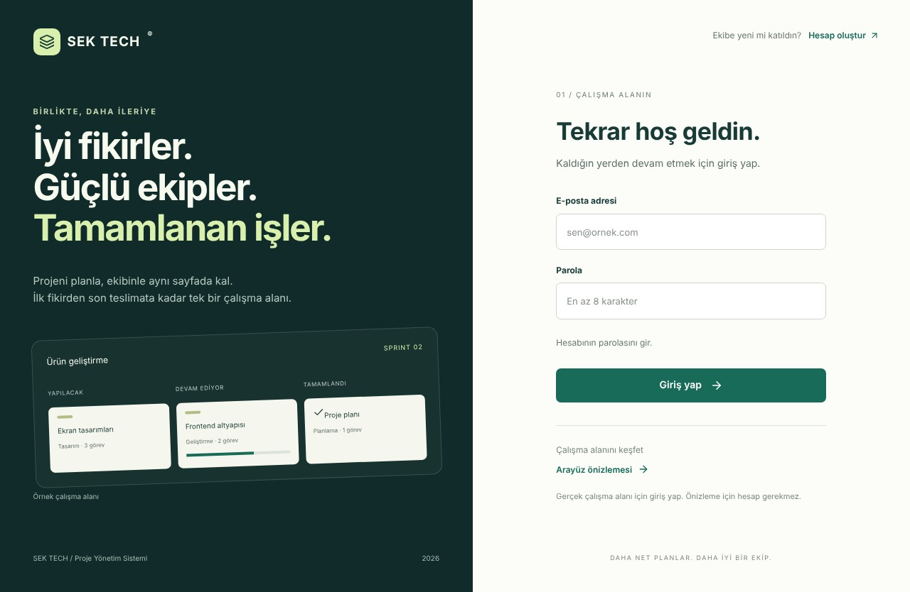
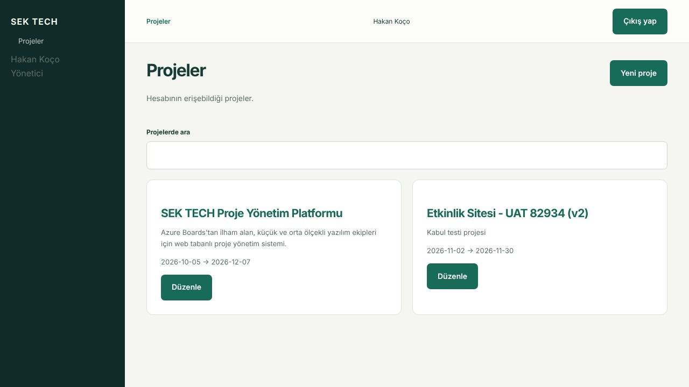
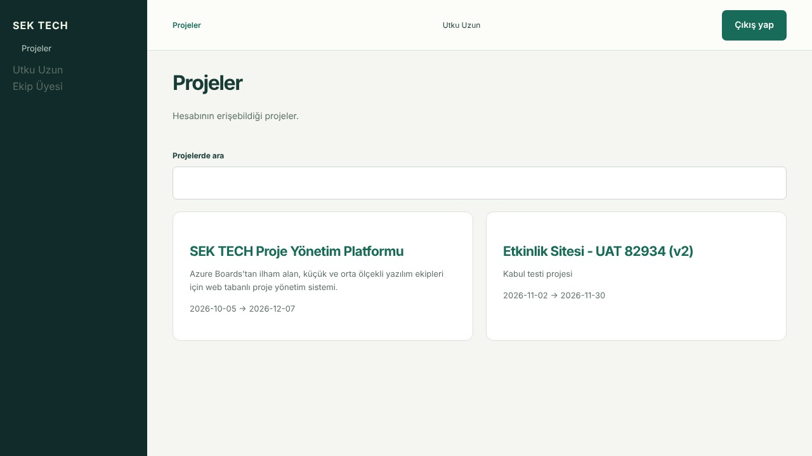
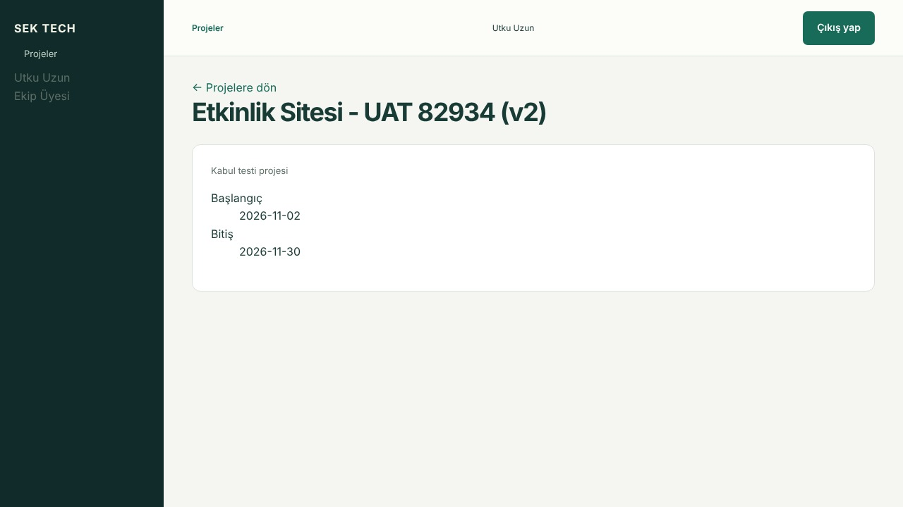
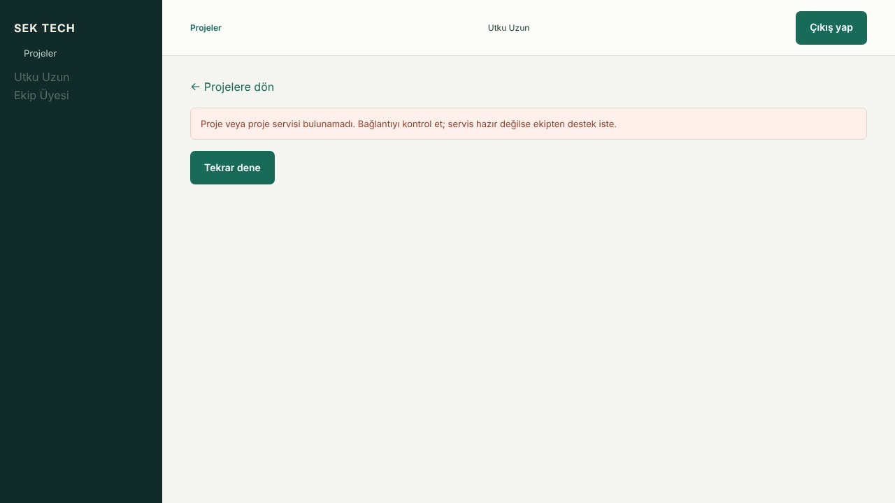
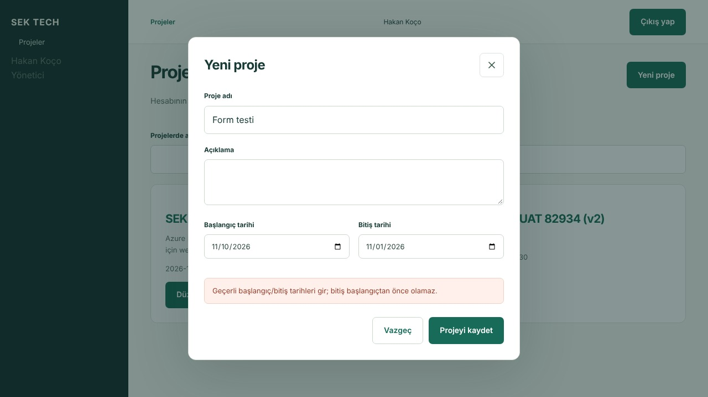

# Haftalık Rapor #4 — Sprint 3 Kapanış Raporu

**Tarih:** 26 Ekim – 1 Kasım 2026 · **Hazırlayan:** Mert Yanık · **Kilometre taşı:** M3

**Durum tarihi:** 1 Kasım 2026 (Türkiye saati). Sprint 3 hafta kapanışı için güncel GitHub kayıtlarıyla yenilenmiştir. Hakan’ın ilgili karar ve kabul kayıtları ile güncel PR durumları ayrı değerlendirilmiştir.

**Sprint hedefi:** Rol tabanlı yetkilendirmeyi ve proje oluşturma–düzenleme akışını uçtan uca çalıştırmak (Modül 2 + Modül 1’in proje kısmı). Kaynak: [proje yol haritası](../yol-haritasi.pdf), Bölüm 6, s. 14 ve [#42](https://github.com/Utkuuzun14/proje-yonetim-sistemi/issues/42). Tatil nedeniyle yaklaşık %80 kapasite, yol haritasındaki kapasite planıdır.

## Haftanın özeti

**Sprint hedefi:** Rol tabanlı yetkilendirme ve proje oluşturma–düzenleme akışını uçtan uca çalıştırmak. **Teknik sonuç:** #109 RBAC/proje API’si, #107 veritabanı altyapısı, #108 hata düzeltmeleri, #93 gerçek API’ye bağlı arayüz ve #101 otomatik kabul testleri birleşti; Docker Compose tam sistem kurulumu ve nginx üzerinden API akışı kayıtlı CI testleriyle doğrulandı.

**Kabul ve zaman sırası:** Abdulkahhar’ın ürün sahibi görevlerini Hakan bu sprint için geçici olarak üstlendi. Hakan’ın 30 Ekim tarihli [#41 kabul kaydı](https://github.com/Utkuuzun14/proje-yonetim-sistemi/issues/41#issuecomment-6528016025), #93’ün `ce1edca` sürümünde 9 senaryodan 8’inin geçtiğini, RP-07’nin #110 nedeniyle kaldığını bildiriyor. 1 Kasım kapanış duyurusunda #110 Sprint 4’ün ilk işi olarak devredildi; ardından [#124](https://github.com/Utkuuzun14/proje-yonetim-sistemi/pull/124) birleşti ve #110 kapandı. RP-07’nin ürün sahibi tarafından tekrar koşulması ve nihai kabul kaydı bekleniyor.

**Açık işler:** RP-07 tekrar kabulü, #36 Figma bağlantısı ve tasarım onayı, #34 ürün adı/kimlik kararı. #40 kapanış burndown verisi yayımlandı; #40 ve #100 kapandı. #119–#123 belge PR’ları incelemededir.

## Bu hafta yapılanlar

Ekip teslimatları ve incelemedeki çıktılar aşağıda özetlenmiştir.

| Kişi | Yapılan iş | Kart / PR |
|---|---|---|
| Hakan Koço | 29 Ekim’de sekiz karar yayımlandı. Ürün sahibi sorumluluğunu bu sprintte üstlenerek SRS, backlog ve kabul planını onayladı; #41’de 8/9 senaryoyla koşullu kabul kaydı oluşturdu. #110’u Sprint 4’ün ilk işi olarak devretti. #114–#118’i gelecek sprintlerde kart sahiplerince ele alınmak üzere birleştirmeden kapattı. [20.00 kapanış kaydında](https://github.com/Utkuuzun14/proje-yonetim-sistemi/issues/40#issuecomment-6561066633) burndown gerçekleşmesi Cuma 10, Pazar #40 kapanmadan önce 8, kapandıktan sonra 7 olarak yayımlandı. | [#96](https://github.com/Utkuuzun14/proje-yonetim-sistemi/issues/96#issuecomment-6497201808), [#41 kabul kaydı](https://github.com/Utkuuzun14/proje-yonetim-sistemi/issues/41#issuecomment-6528016025), [#110 devir kararı](https://github.com/Utkuuzun14/proje-yonetim-sistemi/issues/110#issuecomment-6527697891), #40; PR #111–#118 |
| Abdulkahhar Türkoğlu | **Birleşti:** Ümit’in hazırladığı SRS v1.1 (#111), H4–H5 backlog/tasarım kabul belgesi (#112), rol/proje kabul planı ve MVP demo taslağı (#113). Hakan ürün sahibi olarak onayladı. #41’de manuel test yapılmıştır: RP-01…RP-09 için **8/9 başarılı**; RP-07 (#110) başarısız, kabul koşullu. Nihai kabul için RP-07 tekrar koşulmalı. #34 ve #97 açık; #34’te Figma onayı ve ürün adı kararı bekliyor. | [#111](https://github.com/Utkuuzun14/proje-yonetim-sistemi/pull/111), [#112](https://github.com/Utkuuzun14/proje-yonetim-sistemi/pull/112), [#113](https://github.com/Utkuuzun14/proje-yonetim-sistemi/pull/113), [#41](https://github.com/Utkuuzun14/proje-yonetim-sistemi/issues/41#issuecomment-6528016025), #34, #97 |
| Mert Yanık | **İnceleme durumu:** #119’un önceki sürümü ve #120–#122 aktarımları Utku’nun 1 Kasım incelemesinde onay aldı; PR’lar açık. #119’un tutanak taşıma/şablonu geri getirme commit’i sonrasında eski onayı GitHub’da DISMISSED durumuna geçti; güncel sürüm için yeniden nihai onay bekleniyor. Geçmiş raporlar plan kaydıdır. Rapor #4 bu PR’da 1 Kasım son durumuna getirildi. Hakan’ın Mert’e ilettiği mesajda güncel raporun **1 Kasım 2026 saat 21.00’e kadar (Türkiye saati)** kendisine iletilmesi istendi. PR incelemededir. | #21 → [#119](https://github.com/Utkuuzun14/proje-yonetim-sistemi/pull/119), #120; #28 → #121; #35 → #122; #42 → [#123](https://github.com/Utkuuzun14/proje-yonetim-sistemi/pull/123) |
| Ümit Efe Özkaleli | **Birleşti:** #93 (`ce3dcc8`) ile React arayüz, JWT oturumu, proje ekranları ve tek komutla PostgreSQL + API + nginx/arayüz kurulumu develop’a alındı; #22/#29 kapandı. Zorunlu **TRUST_PROXY** düzeltmesi `0180503` ile eklendi ve Utku onayladı: aynı IP beş başarısız girişten sonra 429, farklı IP başarılı girişte 200; nginx istemcinin uydurduğu X-Forwarded-For bilgisini güvenilir istemci kimliği olarak kullanmıyor. #111–#113 de birleşti. Arayüz kabulü Figma tasarım onayı yerine geçmez: #96 Karar 5 ana ekranların Figma’da çizilmesini istiyor; #36 açık; Hakan kapanış duyurusunda Figma bağlantısının **2 Kasım Pazartesi’ye kadar** paylaşılmasını istedi, tasarım onayı bu çıktıya bağlı. | [#93](https://github.com/Utkuuzun14/proje-yonetim-sistemi/pull/93), [son teknik onay](https://github.com/Utkuuzun14/proje-yonetim-sistemi/pull/93#pullrequestreview-5727907872), #22, #29, #36; PR #111–#113 |
| Mustafa Şahin | **Birleşti:** #109 ile RBAC, Yönetici kullanıcı ekleme/rol atama, proje CRUD ve üyelik API’leri; #108 ile kimlik/gövde/Türkçe doğrulama düzeltmeleri teslim edildi. **Devir ve güncel sonuç:** Hakan #110’u Sprint 4’ün ilk işi, 8 Kasım demosundan önce kapanacak iş olarak belirledi; sonrasında #124 (`2d6cd30`) birleşti ve #110 kapandı. Başkasının kullanıcı detayı 403, kendi kaydı 200; Yönetici erişimi korunuyor. | [#109](https://github.com/Utkuuzun14/proje-yonetim-sistemi/pull/109), #108; [#110 kararı](https://github.com/Utkuuzun14/proje-yonetim-sistemi/issues/110#issuecomment-6527697891), [#124](https://github.com/Utkuuzun14/proje-yonetim-sistemi/pull/124) |
| Buğra Durmuş | **Birleşti (30 Ekim):** Rol/yetki ve proje üyeliği şeması, tarih bütünlüğü kısıtı, indeksler, yetki/üyelik örnek verisi ve repository desteği develop’a alındı. #45 kapalı; PR’da inceleme onayı var. | #45 → [PR #107](https://github.com/Utkuuzun14/proje-yonetim-sistemi/pull/107), merge commit `9eb2eb3` |
| Utku Uzun | **Birleşti:** Test Turu #1 (#106), sadeleştirilmiş rapor şablonu (#95) ve RBAC/proje kabul testleri (#101, 25 test); #46 kapandı. #93 TRUST_PROXY düzeltmesini, #124’ü, #111–#113 ve #119–#122’yi inceledi. #124 incelemesinde 114/114 başarılı test ve kullanıcı detayı erişim kontrolünün manuel doğrulaması kayıtlı.  Test Turu #1’in 20 deneme / 15 geçen / 4 hata / 1 bloke sonucu tarihsel kayıttır. | [#101](https://github.com/Utkuuzun14/proje-yonetim-sistemi/pull/101), [#46](https://github.com/Utkuuzun14/proje-yonetim-sistemi/issues/46), [#124 incelemesi](https://github.com/Utkuuzun14/proje-yonetim-sistemi/pull/124#pullrequestreview-5727911180), #106, #95 |

**Sprint hedefi değerlendirmesi:** Backend, veritabanı, arayüz ve RBAC/proje kabul testleri develop’a birleşti; yönetici proje oluşturma/düzenleme ve Ekip Üyesinin yetkisiz işlemlerde 403 alması kayıtlı testlerle doğrulandı. Teknik uçtan uca akış sağlanmıştır. #41 ürün kabulü 8/9 ile koşulludur; #110 kapanmış olsa da RP-07 tekrar sonucu ve nihai kabul kaydı yoktur. #36 Figma tasarım onayı da açık kalmıştır. Kapanış burndown verisi aşağıda açık kart sayılarıyla verilmiştir; bu gösterge teknik tamamlanma yüzdesinden ayrı değerlendirilir.

**Proje dokümanına API bağlantıları:** [API sözleşmesi](https://github.com/Utkuuzun14/proje-yonetim-sistemi/blob/2d6cd3076a5d6cc306770bd23d47c81b5abb4610/docs/backend/api-sozlesmesi.md), [OpenAPI v0.5 kaynağı](https://github.com/Utkuuzun14/proje-yonetim-sistemi/blob/2d6cd3076a5d6cc306770bd23d47c81b5abb4610/server/src/docs/openapi.yaml), [backend çalıştırma ve Swagger yönergesi](https://github.com/Utkuuzun14/proje-yonetim-sistemi/blob/2d6cd3076a5d6cc306770bd23d47c81b5abb4610/server/README.md). Bunlar kaynak/yönerge bağlantılarıdır; bu rapor hazırlanırken yeni bir canlı API testi yapılmamıştır.

### Backend

[#109](https://github.com/Utkuuzun14/proje-yonetim-sistemi/pull/109) ile rol izinleri her istekte veritabanından okunuyor; rol değişikliği mevcut JWT ile hemen etkili oluyor. Yönetici kullanıcı ekleyip rol atayabiliyor, proje oluşturup düzenleyebiliyor ve üyelik yönetebiliyor. Ekip Üyesi yalnız üyesi olduğu projeleri okuyabiliyor; proje oluşturma, düzenleme, silme ve üyelik değiştirme işlemleri 403 ile reddediliyor. Üye olmayan için proje detayı 404 döner; proje varlığı açıklanmaz.

[#108](https://github.com/Utkuuzun14/proje-yonetim-sistemi/pull/108), Test Turu #1’in #102/#103/#105 bulgularını giderdi: sınır dışı kimlik 500 yerine 400, 1 MB üstü gövde 500 yerine 413, dizi gövdede Türkçe doğrulama mesajı. [#107](https://github.com/Utkuuzun14/proje-yonetim-sistemi/pull/107) rol/yetki matrisi, üyelik ve repository desteği, indeksler ve `chk_projects_dates` tarih bütünlüğü kısıtını teslim etti.

**#110 → #124 güvenlik düzeltmesi:** Kullanıcı detayında Yönetici herkesi, Ekip Üyesi yalnız kendini okuyabiliyor. Yabancı kimlik var olsa da olmasa da 403; Yönetici için olmayan kimlik 404. Kontrol veritabanı sorgusundan önce yapılıyor. Kaynak: [kullanıcı controller’ı](https://github.com/Utkuuzun14/proje-yonetim-sistemi/blob/2d6cd3076a5d6cc306770bd23d47c81b5abb4610/server/src/modules/users/users.controller.js).

**Uygulanmış endpointler:** Aşağıdaki tablo [router bağlamaları](https://github.com/Utkuuzun14/proje-yonetim-sistemi/blob/2d6cd3076a5d6cc306770bd23d47c81b5abb4610/server/src/app.js), [auth routes](https://github.com/Utkuuzun14/proje-yonetim-sistemi/blob/2d6cd3076a5d6cc306770bd23d47c81b5abb4610/server/src/modules/auth/auth.routes.js), [users routes](https://github.com/Utkuuzun14/proje-yonetim-sistemi/blob/2d6cd3076a5d6cc306770bd23d47c81b5abb4610/server/src/modules/users/users.routes.js), [projects routes](https://github.com/Utkuuzun14/proje-yonetim-sistemi/blob/2d6cd3076a5d6cc306770bd23d47c81b5abb4610/server/src/modules/projects/projects.routes.js) ve [OpenAPI v0.5](https://github.com/Utkuuzun14/proje-yonetim-sistemi/blob/2d6cd3076a5d6cc306770bd23d47c81b5abb4610/server/src/docs/openapi.yaml) üzerinden doğrulandı. Kaynak sürüm `2d6cd30`; yeni canlı API testi yapılmadı. `:id` ve `:userId`, OpenAPI’deki `{id}` ve `{userId}` yol parametreleridir.

| Yöntem | Endpoint | Kural / beklenen başarılı yanıt |
|---|---|---|
| GET | `/api/health` | Servis/veritabanı sağlıklıysa 200; VT yoksa 503 |
| POST | `/api/auth/register` | Kayıt, varsayılan Ekip Üyesi, 201 |
| POST | `/api/auth/login` | Giriş/JWT, 200; hatalı parola 401, deneme sınırı 429 |
| GET | `/api/auth/me` | Oturumdaki kullanıcı, 200; oturumsuz 401 |
| GET | `/api/users` | Yönetici, 200; Ekip Üyesi 403 |
| POST | `/api/users` | Yönetici kullanıcı ekler, 201 |
| GET | `/api/users/:id` | Yönetici veya kendi kaydı, 200; yabancı kimlik 403 (#124) |
| PATCH | `/api/users/:id/role` | Yönetici rol atar, 200; kendi rolünü değiştirme 400 |
| GET | `/api/projects` | Yönetici tümünü, Ekip Üyesi üyeliklerini listeler, 200 |
| POST | `/api/projects` | Yönetici oluşturur, sahip ve üye olur, 201 |
| GET | `/api/projects/:id` | Yetkili kullanıcı detayı/üyeleri okur, 200; üye olmayan 404 |
| PATCH | `/api/projects/:id` | Yönetici günceller, 200; tarih sırası kontrol edilir |
| DELETE | `/api/projects/:id` | Yönetici siler, 204 |
| POST | `/api/projects/:id/members` | Yönetici üye ekler, 201; tekrar 409 |
| DELETE | `/api/projects/:id/members/:userId` | Yönetici üye çıkarır, 204 |

Swagger arayüzü `/api/docs`, JSON belge `/api/openapi.json` adresindedir. OpenAPI’de `x-durum: planlandı` olan görev, yorum, dosya ve rapor endpointleri sonraki sprintlerde uygulanacaktır.

### Frontend

[#93](https://github.com/Utkuuzun14/proje-yonetim-sistemi/pull/93) (`ce3dcc8`) giriş/JWT oturumu, proje listesi, proje detayı ve Yönetici için oluşturma/düzenleme formunu teslim etti. `/giris` gerçek oturuma, `/uygulama/projeler` API verisine bağlıdır; `/onizleme` demo alanıdır. [gerçek proje ekranı kodu](https://github.com/Utkuuzun14/proje-yonetim-sistemi/blob/2d6cd3076a5d6cc306770bd23d47c81b5abb4610/client/src/live/Projects.tsx) Yöneticiye “Yeni proje”, “Düzenle” ve “Projeyi düzenle” düğmelerini gösterir; Ekip Üyesine göstermez. Yetki kontrolü yalnız arayüzde değil backend’de de uygulanır. Kullanıcı/rol ve proje üyeliği yönetimi API’de vardır; üyelik yönetimi arayüzü sonraki işler arasındadır.

[Docker Compose](https://github.com/Utkuuzun14/proje-yonetim-sistemi/blob/2d6cd3076a5d6cc306770bd23d47c81b5abb4610/docker-compose.yml) ile `docker compose up --build -d`, PostgreSQL + Express API + nginx/React sistemini başlatır; arayüz `http://localhost:3000`, Swagger `http://localhost:5000/api/docs`. Compose PostgreSQL 15-alpine kullanır; #41’in tarihsel kabul ortamı ayrıca PostgreSQL 16 olarak kaydedilmiştir. 

**TRUST_PROXY:** #93’e `0180503` ile `TRUST_PROXY: "true"` eklendi; Express tek proxy’ye güveniyor. [Compose smoke testi](https://github.com/Utkuuzun14/proje-yonetim-sistemi/blob/2d6cd3076a5d6cc306770bd23d47c81b5abb4610/scripts/compose-smoke.mjs) aynı istemcinin beş yanlış girişten sonra 429, başka istemcinin doğru girişle 200 almasını ve nginx’in gerçek peer bilgisini esas almasını kontrol ediyor. [Utku’nun son teknik onayı](https://github.com/Utkuuzun14/proje-yonetim-sistemi/pull/93#pullrequestreview-5727907872) düzeltmeyi doğruluyor. Yayında API portunun doğrudan açılmaması #73 kapsamındadır.

#### Kullanıcı ekranları ve gözlenen davranışlar

Altı ekran görüntüsü, giriş ve proje ekranlarını, rol farklarını ve doğrulama davranışlarını göstermektedir.

| Ekran | Görsel | Gözlem / sınır |
|---|---|---|
| Yönetici proje listesi — Hakan Koço | [Yönetici proje listesi](img/yonetici-proje-listesi.png) | İki proje kartı, “Yeni proje” ve “Düzenle” düğmeleri görünür. |
| Ekip Üyesi proje listesi — Utku Uzun | [Ekip Üyesi proje listesi](img/ekip-uyesi-proje-listesi.png) | Proje kartları görünür; oluşturma/düzenleme düğmeleri yoktur. |
| Ekip Üyesi proje detayı — Utku Uzun | [Ekip Üyesi proje detayı](img/ekip-uyesi-proje-detayi.png) | Proje açıklaması ve tarihleri görünür; düzenleme düğmesi yoktur. |
| Giriş ekranı | [Giriş ekranı](img/giris-ekrani.png) | E-posta/parola formu görünür.  |
| Üye olmayan kullanıcının erişiminin engellenmesi — RP-02 | [RP-02 erişim ekranı](img/ekip-uyesi-proje-hata-ekrani.png) | Üyesi olmadığı projenin ayrıntıları kullanıcıya gösterilmez; kabul testindeki beklenen yetki davranışıdır. |
| Yeni proje formu — tarih uyarısı | [Tarih doğrulama uyarısı](img/yeni-proje-formu-tarih-uyarisi.png) | Bitiş tarihi başlangıçtan önce olduğunda doğrulama uyarısı gösterilir. |

**Giriş ekranı:** E-posta ve parola alanları ile giriş düğmesi.

**Yönetici proje listesi:** Hakan Koço hesabında oluşturma ve düzenleme kontrolleri görünür.

**Ekip Üyesi proje listesi:** Utku Uzun hesabında aynı yönetici kontrolleri görünmez.

**Ekip Üyesi proje detayı:** “Etkinlik Sitesi - UAT 82934 (v2)” açıklaması ve 2026-11-02 / 2026-11-30 tarihleri görünür.

**Tarih validasyonu:** Yeni proje formunda başlangıç `11/10/2026`, bitiş `11/01/2026` girildiğinde bitiş tarihi başlangıçtan önce kaldığı için uyarı gösteriliyor. [ProjectEditor](https://github.com/Utkuuzun14/proje-yonetim-sistemi/blob/2d6cd3076a5d6cc306770bd23d47c81b5abb4610/client/src/live/Projects.tsx), backend tarih şeması ve veritabanı kısıtı aynı sıra kontrolünü uyguluyor. #41 RP-08’de tarihler düzeltildikten sonra kayıt başarılı. Arayüzde tarihlerin zorunlu, API’de isteğe bağlı olması ürün sahibiyle netleştirilecek.

**RP-02 — üye olmayan kullanıcının erişimi:** Ekran, üyesi olmadığı projeye erişmeye çalışan Ekip Üyesinin engellenmesini gösteriyor. #41 RP-02’de API 404 yanıtı ve proje detayının gizlenmesiyle doğrulanan bu davranış beklenen yetki kontrolüdür. Eski “Proje veya proje servisi bulunamadı…” metni, güncel [detay mesajında](https://github.com/Utkuuzun14/proje-yonetim-sistemi/blob/2d6cd3076a5d6cc306770bd23d47c81b5abb4610/client/src/live/Projects.tsx) “Proje bulunamadı veya bu projeye erişim iznin yok…” olarak iyileştirilmiştir.

### Test

| Kaynak | Test / sonuç | Yorum |
|---|---|---|
| [#101](https://github.com/Utkuuzun14/proje-yonetim-sistemi/pull/101) | 25 RBAC/proje kabul testi; PR birleşmiş, kaynak incelemede CI başarılı | Yönetici/üye yetkileri, görünürlük, proje CRUD/üyelik, olumsuz senaryolar |
| [#41 kabul kaydı](https://github.com/Utkuuzun14/proje-yonetim-sistemi/issues/41#issuecomment-6528016025) | 30 Ekim’de RP-01…RP-09: **8 geçti, 1 başarısız** | Hakan ürün sahibi olarak yürüttü; RP-07 #110 nedeniyle koşullu kabul |
| [#106 / Test Turu #1](https://github.com/Utkuuzun14/proje-yonetim-sistemi/pull/106) | 26/29 Ekim’de 20 deneme: 15 geçen, 4 hata, 1 bloke | İlk test turunun sonuçları |
| [#124 teknik incelemesi](https://github.com/Utkuuzun14/proje-yonetim-sistemi/pull/124#pullrequestreview-5727911180) | Utku 114/114 başarılı test ve kullanıcı detayı için manuel 403/200/404 kontrolü kaydetti | #110 düzeltmesinin otomatik ve manuel teknik doğrulaması |

1 Kasım’da #41 yorumları yeniden okundu: **#110 sonrası RP-07 tekrar kabulü ve nihai ürün sahibi kabulü yayımlanmamış.** [#101 test dosyasında](https://github.com/Utkuuzun14/proje-yonetim-sistemi/blob/2d6cd3076a5d6cc306770bd23d47c81b5abb4610/server/tests/api/projects.rbac.api.test.js) #110 için `test.todo` hâlâ mevcut; [#124 kullanıcı testleri](https://github.com/Utkuuzun14/proje-yonetim-sistemi/blob/2d6cd3076a5d6cc306770bd23d47c81b5abb4610/server/tests/api/users.admin.api.test.js) gerçek regresyon kontrollerini içeriyor. Todo’nun temizlenmesi test bakımı kapsamında bekliyor.

#### Test ekranları — yetki kontrolü ve tarih doğrulaması

**Test notu:** Ekran görüntüleri ilgili kabul senaryolarını örnekler; yeni test koşumu veya RP-07 nihai tekrar kabulü yerine geçmez.

**RP-02 — üye olmayan kullanıcı engelleniyor:** Kullanıcıya proje ayrıntıları gösterilmiyor; erişim kısıtı kabul senaryosuyla uyumlu.

**RP-08 — yeni proje formunda tarih doğrulaması:** Bitiş başlangıçtan önce olduğunda form “bitiş başlangıçtan önce olamaz” uyarısı gösteriyor.

### Dokümantasyon

| PR | Çıktı ve 1 Kasım durumu |
|---|---|
| [#111](https://github.com/Utkuuzun14/proje-yonetim-sistemi/pull/111) | SRS v1.1 birleşti; #96’nın JWT, şema ve Yönetici yetki kararları işlendi. Hakan geçici ürün sahibi olarak onayladı. |
| [#112](https://github.com/Utkuuzun14/proje-yonetim-sistemi/pull/112), [#113](https://github.com/Utkuuzun14/proje-yonetim-sistemi/pull/113) | Backlog/tasarım kabul ve rol-proje kabul/MVP demo belgeleri birleşti. Belgelerin hazırlanma anındaki “kabul yapılmadı” notu daha sonraki #41 kaydının yerine geçmez. |
| [#119](https://github.com/Utkuuzun14/proje-yonetim-sistemi/pull/119) | Sekiz yazılı karar `docs/tutanaklar/2026-10-29-sprint-3-kararlari.md` dosyasına taşındı; boş karar şablonu geri getirildi. PR açık; güncel değişiklik için nihai inceleme bekliyor. |
| [#120](https://github.com/Utkuuzun14/proje-yonetim-sistemi/pull/120), [#121](https://github.com/Utkuuzun14/proje-yonetim-sistemi/pull/121), [#122](https://github.com/Utkuuzun14/proje-yonetim-sistemi/pull/122) | Eski raporların Markdown aktarımları onaylı, PR’lar açık; geçmiş sprintlerin plan kayıtları korunmuştur. |
| [#123](https://github.com/Utkuuzun14/proje-yonetim-sistemi/pull/123) | Altı ekran görüntüsüyle Sprint 3 kapanış raporu; nihai inceleme bekliyor. |

### Riskler ve açık işler

- **Kabul:** #110 kapanmış olmasına rağmen #41 RP-07 tekrar koşulmalı ve ürün sahibi nihai kabulü kaydedilmeli.
- **Tasarım:** #36 Figma bağlantısı 2 Kasım Pazartesi’ye kadar istendi; tasarım onayı bu çıktıya bağlı. #34 ürün adı/kimlik kararı da bekliyor.
- **Süreç:** [Kapanış kaydına](https://github.com/Utkuuzun14/proje-yonetim-sistemi/issues/40#issuecomment-6561066633) göre #100 kapandı. Kartların PR’larla zamanında kapanması Sprint 4 süreç iyileştirmesi olarak belirlendi.
- **Planlama:** [#114](https://github.com/Utkuuzun14/proje-yonetim-sistemi/pull/114), [#115](https://github.com/Utkuuzun14/proje-yonetim-sistemi/pull/115), [#116](https://github.com/Utkuuzun14/proje-yonetim-sistemi/pull/116), [#117](https://github.com/Utkuuzun14/proje-yonetim-sistemi/pull/117), [#118](https://github.com/Utkuuzun14/proje-yonetim-sistemi/pull/118) Hakan’ın kararıyla birleşmeden kapatıldı; gelecek sprint işleri kendi sprintinde kart sahibi tarafından açılacak.
- **Rapor teslimi:** Son inceleme ve öğretim üyesine iletim için hedef 1 Kasım saat 21.00.

#### Burndown — #40 kontrolü

Başlangıç–29 Ekim değerleri [sprint planından](https://github.com/Utkuuzun14/proje-yonetim-sistemi/issues/40#issuecomment-6497313650), kalan günler [Hakan’ın 1 Kasım 20.00 kapanış kaydından](https://github.com/Utkuuzun14/proje-yonetim-sistemi/issues/40#issuecomment-6561066633) alınmıştır. “Gerçek”, #40–#46 ve #96–#100 kapsamındaki açık Sprint 3 kartı sayısıdır; kapanma saatleri Türkiye saatine göre değerlendirilmiştir.

| Gün | İdeal | Gerçek |
|---|---|---|
| Başlangıç (Pazartesi sabah) | 7 | 7 |
| 26 Ekim Pazartesi | 5 | 7 |
| 27 Ekim Salı | 3 | 7 |
| 28 Ekim Çarşamba (yarım gün) | 2 | 7 |
| 29 Ekim Perşembe (tatil) | 7 | 12 |
| 30 Ekim Cuma | 0 | 10 |
| 1 Kasım Pazar | 0 | 8 → 7 (#40 kapanışı sonrası) |

29 Ekim’de #96–#100 eklenmesiyle kapsam 5 kart arttı. Cuma #44 ve #45 kapandı; gerçekleşen 10 oldu. Pazar #46 ve #100’ün kapanışıyla sayı 8’e, #40’ın kapanışıyla **7’ye** düştü. Kaynaktaki **8 → 7** geçişi korunmuştur. Kapanan beş kart #44, #45, #46, #100 ve #40’tır. Açık kart sayısının yüksek kalmasında, tamamlanan bazı işlerin kartlarının henüz kapatılmaması etkili oldu. Sprint 4’te PR’lara `Closes #kart` eklenmesi ve birleştirmelerin gün içinde yapılması kararlaştırıldı. [Kaynak](https://github.com/Utkuuzun14/proje-yonetim-sistemi/issues/40#issuecomment-6561066633).

## Haftaya yapılacaklar

**Plan dönemi:** 2–8 Kasım 2026, Sprint 4 — Görev Yönetimi & Kanban Panosu. Kaynak: yol haritası Bölüm 6, s. 15 ve #47–#53. Planlanan işler aşağıdadır.

| Kişi | Yapılacak iş | Kart |
|---|---|---|
| Hakan Koço | MVP ara demo ve sprint review organizasyonu; geride kalan MoSCoW maddelerinin yeniden planlanması; onaylı sürüm süreci kapsamında v0.5 hazırlığı. | [#47](https://github.com/Utkuuzun14/proje-yonetim-sistemi/issues/47) |
| Abdulkahhar Türkoğlu | MVP kullanıcı kabul testi ve geri bildirim listesi; müşteri sunumu; görev detay paneli gibi statik bileşenlerde frontend desteği. | [#48](https://github.com/Utkuuzun14/proje-yonetim-sistemi/issues/48) |
| Mert Yanık | Sprint 3 raporu (Rapor #5), doğrulanmış kanıtlarla MVP ara raporu ve ara demo toplantı notları. Yüzde ve burndown verisi ancak ölçüm doğrulanırsa kullanılacak. | [#49](https://github.com/Utkuuzun14/proje-yonetim-sistemi/issues/49) |
| Ümit Efe Özkaleli | Görev listesi/oluşturma/düzenleme, kişi atama seçici, sürükle-bırak Kanban, görev detay paneli ve yorum alanı. | [#50](https://github.com/Utkuuzun14/proje-yonetim-sistemi/issues/50) |
| Mustafa Şahin | #110 için Sprint 4’e devir kararı verilmişti; #124 ile kapandığı için yeniden geliştirme yerine RP-07 tekrar kabulünün takibi yapılmalı. Görev CRUD, atama ve durum güncelleme; yorum endpoint’leri; durum/kişi/tarih filtreleri. | [#51](https://github.com/Utkuuzun14/proje-yonetim-sistemi/issues/51) |
| Buğra Durmuş | Görev, yorum ve durum geçmişi tabloları; her durum değişiminde geçmiş kaydı; gerçekçi demo seed verisi. | [#52](https://github.com/Utkuuzun14/proje-yonetim-sistemi/issues/52) |
| Utku Uzun | #110 düzeltmesi sonrası RP-07 tekrar kabulünü ürün sahibiyle doğrulamak; #101’deki #110 todo’sunun güncel karşılığını kontrol etmek. Görev/yorum API testleri, E2E altyapısı ve ilk Kanban senaryosu; regresyon test listesi. | [#53](https://github.com/Utkuuzun14/proje-yonetim-sistemi/issues/53) |

**Not / engel:** #110 güncel kayıtta kapalıdır; açık güvenlik hatası gibi raporlanmaz. Kalan kabul işi #41 RP-07 tekrar koşumu ve nihai kabul; tasarım işi #36 Figma çıktısı/onayıdır (#34 de açık). #100 pano otomasyonu/koruma kartı kapanış kaydında kapalı; kartların zamanında kapanması Sprint 4 süreç takibinde. #114–#118 karar beklemiyor: Hakan’ın kararıyla birleşmeden kapalı; taslaklar referans olarak duruyor, gelecek sprint işleri ilgili sprintte kart sahibince ele alınacak.

**Kaynaklar:** Hakan’ın 1 Kasım Sprint 3 kapanış duyurusu; #96 yazılı kararları; #41 kabul kaydı; #110 devir kararı; ilgili PR ve inceleme kayıtları; [Test Turu #1](../test/test-turlari/tur-01.md).
